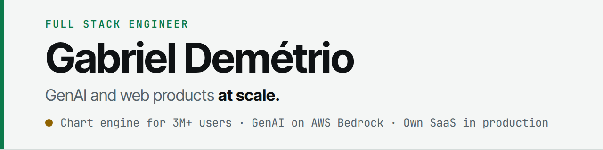

 

*Full Stack Engineer · Remote · Brazil (GMT-3) · GenAI on AWS Bedrock*

<code>TypeScript</code> • <code>React</code> • <code>Node.js</code> • <code>Python</code> • <code>PostgreSQL</code> 
<code>AWS Bedrock</code> • <code>GCP</code> • <code>Kubernetes</code> • <code>Terraform</code> • <code>Prisma</code>

---

## About me

- 5 years building web products from interface to infrastructure, at:
  - **SoftExpert:** multi-stack ERP with 3M+ users. I built the React chart engine they all use and a GenAI assistant on AWS Bedrock that is in production. Now working on the backend AI side of the semantic search engine (AWS vector search).
  - **Terrantic:** analytics platform for agribusiness, Seattle (remote). Data integrations, CDC pipelines and real-time dashboards. Also worked on a data backend with a single ClickHouse table of 20M+ rows.
  - **Marvee:** financial ERP. Frontend refactor, bank and tax integrations, and a React Native app for real-time financial monitoring.
  - **SCI Sistemas Contábeis:** LGPD compliance system in React and Python.
- I build and run **Workly**, my own B2B SaaS for auto repair shops, in production with paying customers since June 2026.
- Open to remote full stack roles with international teams.

## How I work

- **AI agents, human review.** In Workly, a team of AI agents works from approved specs, a tester agent checks every acceptance criterion, and I review every pull request. Merge and deploy stay my decision.
- **Deterministic logic where correctness matters.** The model interprets numbers. It never calculates them.

*Building, shipping and learning in public.*

